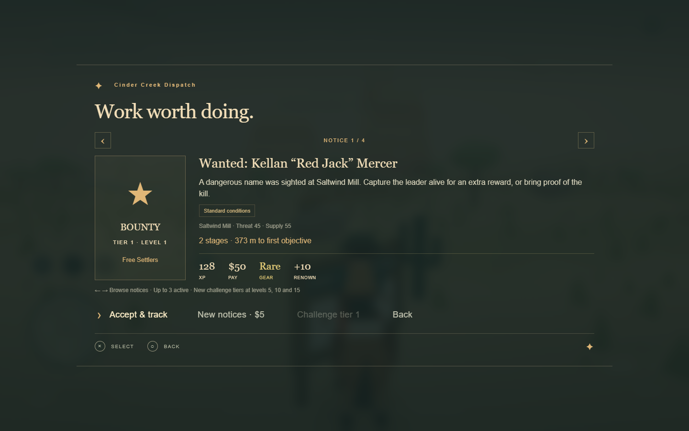
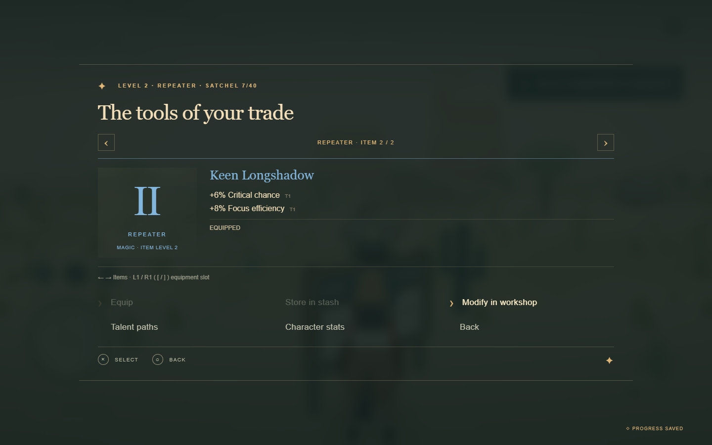
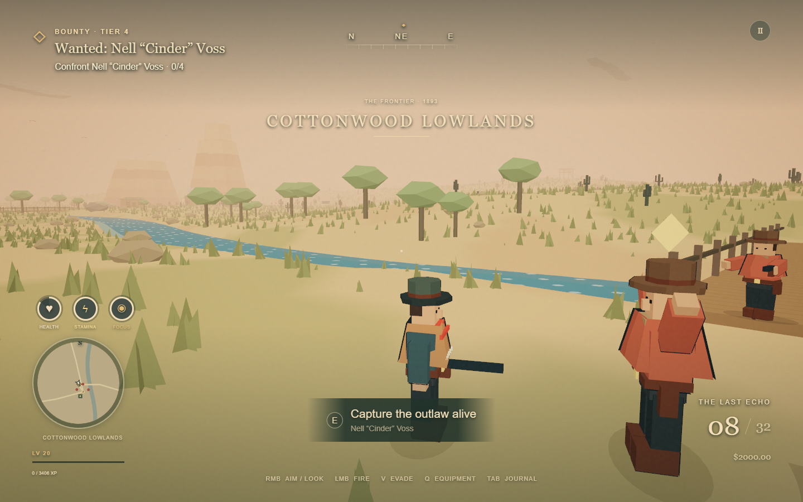

# The frontier campaign

The expanded territory now supports a repeatable campaign with generated work, regional consequences, character builds and an equipment economy. It runs locally, uses the existing WebGPU world and shares the same movement, combat and input systems as the original story.

## Start playing

Visit a **dispatch board** and press **Triangle / E**. The boards are beside Juniper at **Cinder Creek**, next to **Sundown Relay**, and at **Cottonwood Crossing**. All three hubs can be selected as destinations in the atlas.

Browse notices with Left/Right. Accept and track up to three contracts, follow the objective in the world, then return to the issuing hub to claim the reward. The contract journal is available from Pause and the atlas. Nearby field events use that same journal and objective system.

The hub provides the dispatch board, contract journal, equipment, talent paths, workshop, shared stash and trading post. D-pad navigation follows the hub’s two-column layout. Equipment pages use Left/Right for items and L1/R1 for slots. Talents use L1/R1 for paths; the workshop uses it for recipes. Keyboard equivalents are the arrow and bracket keys.

## Generated activities

| Type     | Playable sequence                                                                                                                      |
| -------- | -------------------------------------------------------------------------------------------------------------------------------------- |
| Bounty   | Find a named outlaw and escorts; kill the target or approach below 30% health to capture them. Live capture earns extra pay and honor. |
| Raid     | Defeat a gang and secure its supplies.                                                                                                 |
| Recovery | Search clues, confront the thieves and recover their cargo.                                                                            |
| Courier  | Collect a parcel at the hub and deliver it; dangerous routes can include an ambush.                                                    |
| Escort   | Meet a stranded prospector, stay within 35 m and protect them along the road to a destination. A real ambush threatens the NPC.        |
| Defense  | Protect a supply wagon through three timed waves. The wagon takes damage and can be destroyed.                                         |
| Salvage  | Recover ore deposits and crafting materials. Extraction consumes regional supply and increases threat.                                 |
| Survey   | Visit and investigate three locations.                                                                                                 |
| Supply   | Gather sage and deliver field medicine to a region in need.                                                                            |
| Quest    | Investigate dispatches, break a gang network, choose whether to expose or sell its ledger, defeat its leader and retrieve a relic.     |

The generator combines seeded identities, destinations, factions, enemy families, objective sequences, challenge tiers and conditions. Four tiers unlock at levels **1, 5, 10 and 15**. Eight contract modifiers alter enemy composition or reward quality. A fresh set of notices and vendor stock costs $5.

The Free Settlers, Territory Wardens and Prospectors’ Guild have separate renown. Renown improves prices; **100 renown** unlocks guaranteed Relic rewards on newly generated faction quests.

## Interacting world systems

Every frontier site has **threat** and **supply**. Time increases pressure. Raids and bounties reduce threat, deliveries rebuild supply, and noisy salvage creates demand for more protection. Failed or ignored crises worsen local conditions. Those values influence destinations, extra challenge modifiers, field events and market prices.

The event director creates optional roadside activity using the same objective runtime as hub work. It places encounters along nearby routes, away from hubs and existing active objectives. High threat favors raids; shortages favor defense. Rain can introduce storm conditions. Events expire and make room for future activity.

Enemy families have different movement and damage characteristics. Elites can be armored, frenzied, vampiric, stormbound, venomous or scorched. Gold ground circles warn of elemental attacks before they turn red. **Circle / V** evades, consumes stamina and has a cooldown. Rain strengthens storm damage and weakens burning; water further amplifies storm damage. Frost slows actual movement and attacks.

## Character and loot

- **30 character levels** with talent points, followed by **100 mastery ranks**. Mastery adds health/damage and grants additional points up to the available talent ranks.
- **15 talents** across Gunslinger, Warden and Outrider, including prerequisites, ranked nodes and three capstones. Paths may be mixed. Hub respec refunds the points for a displayed dollar cost.
- **Six equipment slots:** revolver, repeater, coat, boots, charm and saddle. The active weapon contributes its stats; the other weapon stays equipped for switching.
- **Five rarities:** Common, Magic, Rare, Legendary and Relic. Item level determines affix tiers. Fifteen affix families affect damage, criticals, reload, health, armor, resistance, mobility, riding, focus, fortune, healing or salvage.
- **Five powers:** Echoing Lead ricochets, Blood Price bleeding/healing, Stormcaller chain lightning, Trailblazer mounted bonuses and Last Stand barriers. Named Relics add distinct signature bonuses beyond their power.
- **Four runes:** Ember, Frost, Vigor and Fortune.
- **Two sets:** Trailwarden and Iron Oath, with two- and three-piece bonuses.

Loot appears physically in the world with rarity-colored markers. Equipment pages compare a selected item to the equipped item and show its affixes, power, rune and set. The character sheet shows the resulting combat and survival values. These values feed the actual simulation.

## Workshop and economy

| Action           | Result                                                                                                              |
| ---------------- | ------------------------------------------------------------------------------------------------------------------- |
| Temper           | Upgrade equipment to +5; improve its implicit stats and rolled affixes.                                             |
| Reforge          | Reroll the final affix while preserving the other affixes, item power and rune.                                     |
| Etch a rune      | Add or replace a rune using silver and a rune material. Applying the existing rune does not charge again.           |
| Brew             | Convert three gathered herbs into two tonics.                                                                       |
| Salvage          | Destroy unequipped gear for materials; higher rarities yield more valuable materials. Equipped items are protected. |
| Store / withdraw | Transfer the exact item between a 40-item satchel and an 80-item shared stash.                                      |
| Trade            | Purchase rotating equipment and ordinary supplies; prices respond to supply and renown.                             |

Costs are displayed before actions. Failed purchases, insufficient materials and protected-item operations do not partially charge the player. Contract rewards are claimed once. If both storage areas are full, reward collection waits for room. Distant expired ground loot is sent to the stash or converted to materials when the stash is full; the world-drop pool also has a fixed budget.

## Persistence and the demo

Existing version-1 stories receive a new campaign state and starter equipment without losing their story, position, health, money or discoveries. Generated contracts, actor identities, objective progress, decisions, gear, talents, materials, regional state and random counters are serialized. New-game replacement still requires confirmation. **Ride it again** restarts the original story while retaining the character and campaign.

The ten-second attract loop now plays the original story, visits a hub, accepts a real salvage contract, completes it, returns for the reward, equips and upgrades the item, then starts again. It uses the same actions and service methods as the player. Any input returns to title, and demo activity never writes the player’s save.

## Engine handoff

| Module                           | Role                                                                                                            |
| -------------------------------- | --------------------------------------------------------------------------------------------------------------- |
| `engine/campaign/types.ts`       | Serializable campaign, objective, item, actor and hazard contracts                                              |
| `game/campaign/catalog.ts`       | Hubs, factions, items, affixes, powers, relic signatures, runes, sets, talents, enemy families and consequences |
| `engine/campaign/generator.ts`   | Seeded objective composition, offers, conditions and quoted rewards                                             |
| `engine/campaign/runtime.ts`     | Acceptance, objective execution, spawned actors, events, turn-in, regional consequences and world limits        |
| `engine/campaign/navigation.ts`  | Connected escort routes and local obstacle detours                                                              |
| `engine/campaign/loot.ts`        | Item rolls, rarity/affix tiers, upgrade costs, salvage and reforge results                                      |
| `engine/campaign/progression.ts` | XP, mastery, talent rules and shared derived-stat calculation                                                   |
| `engine/campaign/combat.ts`      | Criticals, powers, status effects, mitigation and hazard impacts                                                |
| `engine/campaign/gear.ts`        | Equipment, stash, workshop, market and respec transactions                                                      |
| `engine/campaign/validation.ts`  | Validation of durable campaign state and references                                                             |
| `engine/campaign/queries.ts`     | Shared tracked-objective navigation                                                                             |
| `game/campaign/demo.ts`          | Autonomous hub/job/reward demonstration                                                                         |
| `render/campaign-view.ts`        | Hub boards, reusable enemy rigs, objectives, physical loot and warning circles                                  |
| `ui/campaign-ui.ts`              | Controller-oriented hub, journal, item comparison, talents, workshop, stash and character pages                 |

Add activities by composing the existing `reach`, `interact`, `eliminate`, `defend`, `escort` and `choice` verbs. Add item/skill/enemy content to the catalogs and keep derived stats as the shared source for combat and UI. Adding genuinely new mechanics requires a new typed verb/effect and its tests, rather than another independent game loop.

Limits are explicit: three accepted contracts, two field events, 48 campaign enemies, 64 ground drops, 100 retained completion records, and bounded inventory/stash capacity. Objective cleanup releases actor references; rendering reuses enemy rigs and shared geometry/materials. Item/contract IDs and random counters persist, and completed IDs guard reward transactions.

## Verification

**59 engine tests passed**, covering every activity type through reward turn-in, procedural reproducibility/variation, live capture, quest consequences, real NPC damage, failure/retry, leveling/talents, item effects, weather/status interactions, dodge, crafting, capacity rules, persistence, a 110-contract run, and a full story-plus-campaign attract cycle. Original story/map tests remain in the suite.

Native Windows Chrome with the NVIDIA adapter passed:

- **14 campaign journey checks:** physical hub access, spatial gamepad focus, accepting a job, actual riding/gathering, turn-in, equipment, talent spending, upgrading, rune insertion, reload, real bounty combat, ground loot and return.
- **13 advanced checks:** all hubs, reforge, stash, trade, respec, fully affixed equipment layouts, world capture prompt, timed lightning evasion, quest choice and reload.
- **19 regression checks**, including the extended demo’s real contract/upgrade and byte-for-byte save isolation.
- A focused atlas check for all three hubs, selecting/tracking one, and restoring it after reload.
- **24 viewport-matrix checks** with zero reported overflow, JavaScript/console errors or failed requests. WebKit/Firefox compatibility screens were checked; native Chrome rendered gameplay. Real iOS Safari and a physical DualSense were unavailable.

The primary browser journey recorded a median of **60 FPS** on the available RTX 3060 Ti. Its samples include startup stalls (minimum 1, maximum 61); this is an observed session, not a locked-rate or RTX 4070 Super benchmark.

Run `npm run check`, `npm run test:campaign-browser`, and `npm run test:browser` against a running build. For targeted advanced scenarios, first run `npm run fixtures:campaign`, then `npm run test:campaign-details`. The fixture script is offline QA tooling and is not included in the shipped application. Primary journey tests use actual gameplay input; advanced tests arrange valid saves for targeted inspection.

Records: [campaign journey](verification/campaign-browser-report.json), [advanced scenarios](verification/campaign-details-report.json), [extended regression](verification/campaign-regression.json).

