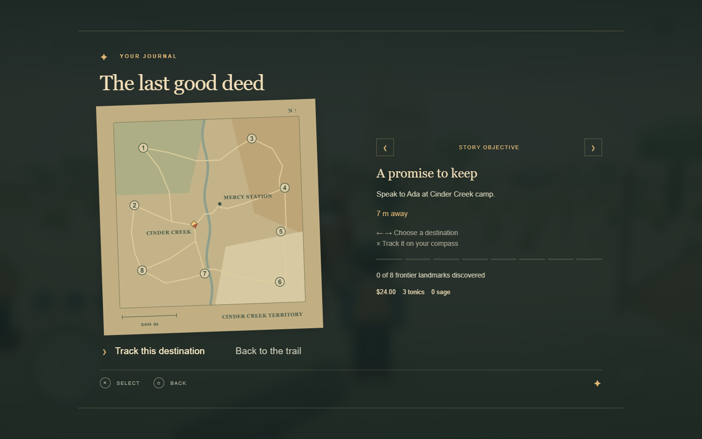
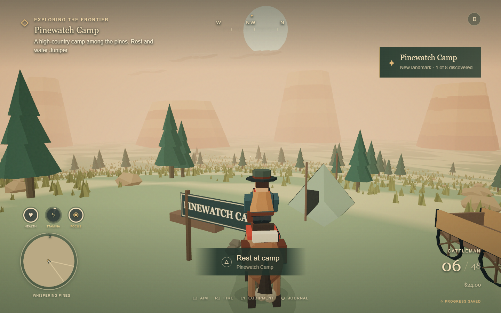
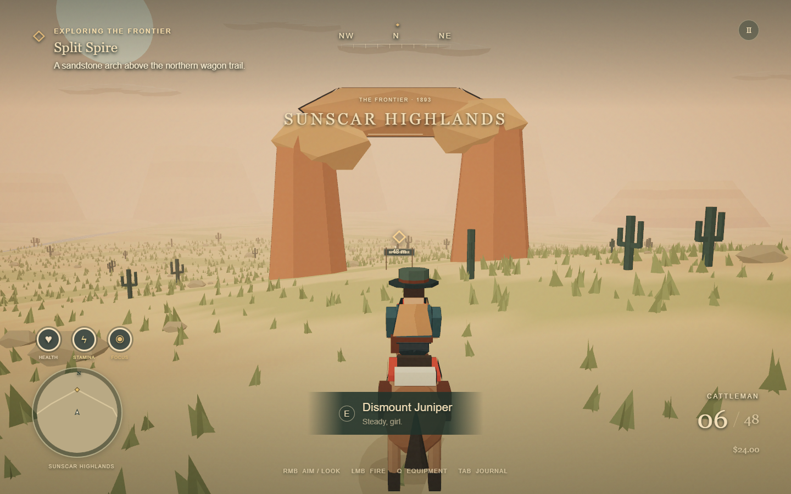

# Tenfold territory expansion

The playable territory has **exactly 10 times the original area**. The baseline is commit `b8b1975`, where movement was clamped to ±108 metres on each axis.

| Measurement                       |    Original |                          Expanded |
| --------------------------------- | ----------: | --------------------------------: |
| Width × depth                     | 216 × 216 m | approximately 683.052 × 683.052 m |
| Playable area                     |   46,656 m² |                        466,560 m² |
| Movement bounds on each axis      |      ±108 m |                     ±341.525987 m |
| River crossings                   |           1 |                                 3 |
| Additional connected trail routes |           — |                                10 |
| New discoverable destinations     |           — |                                 8 |

The width and depth each grow by `sqrt(10)`. Character sizes, horse speed, buildings and weapon distances remain in metres. The original medicine mission occupies the central territory, with the new regions surrounding it.

## What was added

| Destination         | Region              | Feature                                               |
| ------------------- | ------------------- | ----------------------------------------------------- |
| Pinewatch Camp      | Whispering Pines    | Elevated pine forest, camp rest and a trail story     |
| Old Copper Mine     | Redwash Canyon      | Abandoned mine entrance, ore track and wagon          |
| Split Spire         | Sunscar Highlands   | Large sandstone arch beside the northern route        |
| Sundown Relay       | Sunscar Highlands   | Telegraph station, poles, wires and wagon             |
| Red Mesa Lookout    | Sunscar Highlands   | Watchtower on the rolling eastern ridge               |
| Saltwind Mill       | Saltwind Flats      | Water tower and animated windmill                     |
| Cottonwood Crossing | Cottonwood Lowlands | Southern bridge and old ferry landing                 |
| Settlers’ Rest      | Cottonwood Lowlands | Western camp and a place to restore rider/horse cores |

The map now has a connected northern, eastern, southern and western trail network. The river and scenery extend across the new territory. Vegetation density is maintained through instancing in 64 spatial groups, with distant groups culled; terrain uses 64 tiles. Wildlife is distributed across five areas. Camera range and the sky cover the enlarged world.

Open the journal, cycle destinations with D-pad Left/Right or the arrow keys, and select **Track this destination**. The chosen landmark appears in the HUD, compass marker and minimap. Discoveries are recorded once and persist in the story save. Choose the story objective in the atlas to return to mission guidance.

## Save compatibility

The existing save key and version remain supported. Old version-1 saves gain empty discovery state and an unset exploration destination. Their health, inventory, coordinates and mission state are retained. New saves accept positions throughout the enlarged territory, including the horse and enemies.

## Verification

- **22 engine tests passed**, including seven new tests for exact area, all movement bounds, terrain heights, trail-network connectivity, actual mounted traversal of every rendered new trail, all three bridges, old-save migration, outer-corner persistence, discovery/rest behavior, and atlas projection.
- **19 native-browser expansion checks passed**. The browser mounted Juniper through normal input and physically rode from the original camp to Pinewatch using Gamepad API controls. It discovered the camp, saved beyond the old boundary, reloaded there, migrated a legacy save, rendered/discovered all eight landmarks and exercised the atlas at multiple sizes.
- **18 original browser-flow checks passed again** on the expanded map, including the full mission in attract mode, automatic restart, the 10-second idle gate, controller input and byte-for-byte save isolation.
- **24 viewport-matrix checks passed** with zero overflow, JavaScript, console or request errors. WSL WebKit/Firefox checks cover the WebGPU compatibility UI; native Windows Chrome rendered the actual game.
- The final atlas fits without horizontal or internal vertical overflow at **1440 × 900, 768 × 1024, 1366 × 768 and 2560 × 1080**. Native screenshots of the atlas and every new landmark were inspected. Phone gameplay remains the world and menu button only.
- The physical ride recorded **228 frame-rate samples, median 60 FPS, minimum 18, maximum 60** on the available RTX 3060 Ti at 1440 × 900. Startup/rendering stalls are included; this is not a locked-frame-rate guarantee or an RTX 4070 Super benchmark.

Reproduce with `npm run check` and `npm run test:territory` against a running WebGPU browser build. The test's initial ride uses actual gameplay input. Additional landmark visual checks arrange valid saves to inspect distant locations efficiently; they do not add production teleport/debug commands.

Evidence: [expansion browser report](verification/territory-report.json), [regression report](verification/territory-regression.json), [atlas fit measurements](verification/atlas-layout-report.json).

