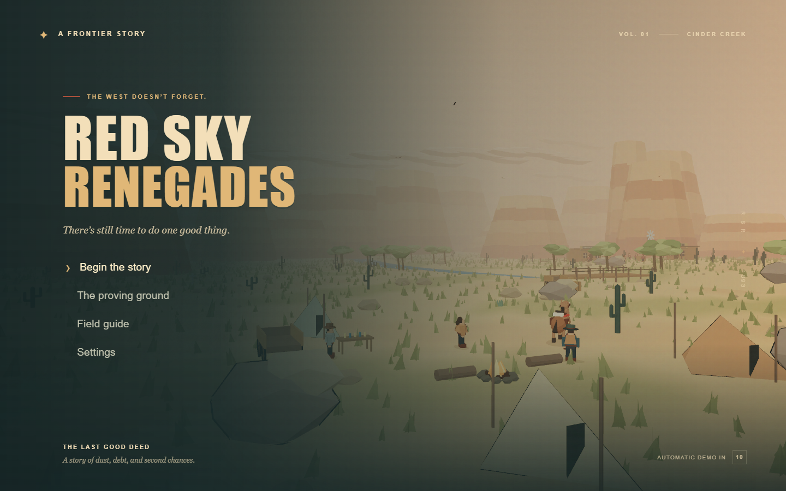
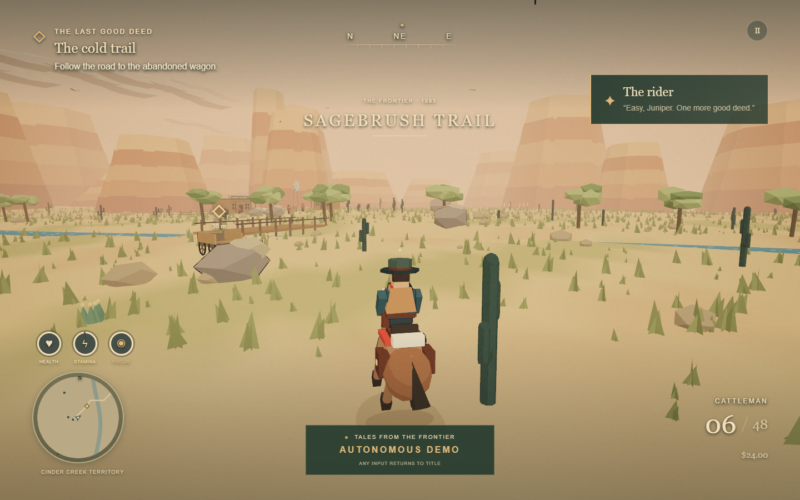
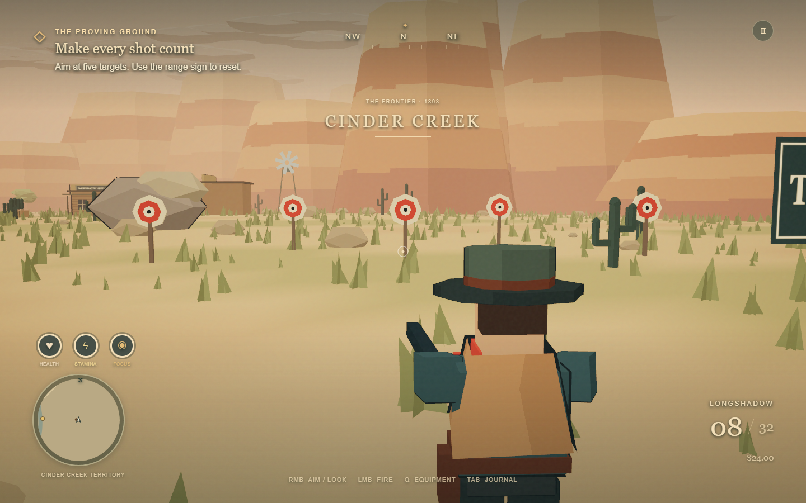

# Verification record

Date: **2026-10-16**. This record distinguishes actual gameplay rendering from compatibility screens and simulated controller input from a physical controller test.

## Automated engine checks

`npm run check` runs **15 passing tests**, strict TypeScript compilation, and the production Vite build. The suite covers:

- Complete story progression through all nine mission states, five defeated outlaws, the mercy choice, supply delivery, rewards and the ending.
- Three fresh autonomous cycles using ordinary gameplay commands.
- A second, branching mission graph authored entirely as data; invalid graph rejection.
- Serialized checkpoint roundtrip, unsupported versions, malformed/incomplete state, nonfinite values, and unavailable storage.
- Collision, cover occlusion, the bridge surface, finite ammunition and reload.
- Focus time, consumable limits, trader proximity/prices, witnessed gunfire and heat decay.
- Quest-gated medicine and completion, horse mount/dismount/call, and the resettable proving ground.

## Native browser gameplay

**Chrome 155.0.8059.84 on Windows, NVIDIA WebGPU / Ampere, RTX 3060 Ti.** Native renderer screenshots were inspected. The requested RTX 4070 Super was not available for measurement.

The main browser journey passed **18 checks**. It starts a real game, moves through keyboard input, pauses, changes settings, opens the journal, equips the repeater with the wheel, saves, reloads and continues. A standard-mapped synthetic DualSense then navigates menus and moves the player through the browser Gamepad API.

The idle test measured attract entry at **10.008 seconds**. The renderer remained active while the director traversed every story stage, completed delivery, displayed the ending, and began the next cycle. The story save remained **byte-for-byte unchanged**. Pointer movement, a controller button, and a keyboard key each interrupted the demo to the title. No browser errors were recorded.

The recorded mission samples were **60 FPS at 1440 × 900** (120 samples, minimum/median/maximum all 60). These are observed test-session samples with the browser’s frame cadence, not a benchmark guarantee for every resolution or GPU.

A second browser journey passed **12 checks** covering exact damaged-health continuation, death from hostile gunfire, checkpoint retry and temporary protection, player target hits, ammunition transfer during reload, the corrected aiming pose, restored rain/fog, and live rendering at phone, tablet, laptop and ultrawide dimensions.

Machine-readable records are retained in [browser-report.json](verification/browser-report.json) and [browser-details-report.json](verification/browser-details-report.json). Reproduce with `scripts/browser-check.mjs` and `scripts/browser-details.mjs` against a running build. The detail test arranges scenarios through the public save schema in an isolated test context; it does not use production cheats.

## Viewports and WebKit

`viewport-matrix http://localhost:5188 -o /tmp/red-sky-qa/viewports --dpr1` produced **24 clean screenshots**, with **zero overflow reports, console errors, JavaScript errors, or failed requests**. It covered small phones, foldables, tablets, 4:3, laptops, 16:10, 16:9 and 21:9, using Chromium, WebKit and Firefox where appropriate.

The WSL engines without WebGPU display the explicit compatibility screen; this checks that screen and its layout, **not gameplay on those engines**. Phone layouts show only the world/menu button as requested. A separate native Chrome test rendered the actual game at **375 × 667, 768 × 1024, 1366 × 768, and 2560 × 1080**; screenshots were inspected and no horizontal overflow was found.

Linux Playwright WebKit is the closest available automated approximation to Safari. Real iOS Safari was unavailable. Physical DualSense ergonomics, radio connectivity and haptics were not measured; standard mapping, dead zones, button transitions and analog controls were exercised through the Gamepad API.

## Rendering investigation

The initial Linux SwiftShader WebGPU path reported a successful backend but produced corrupted or black imagery. Direct rendering and a minimal WebGPU probe isolated this as a software-driver/test-environment limitation. Native Windows Chrome on the NVIDIA adapter rendered the full scene and post-processing correctly. The application continues to use WebGPU exclusively; no renderer fallback was added.

## Requirement audit

| Brief requirement                                                      | Evidence                                                                                                                                                    |
| ---------------------------------------------------------------------- | ----------------------------------------------------------------------------------------------------------------------------------------------------------- |
| Read original brief; use model knowledge without web research          | Original attachment read before implementation; no web searches; authored geometry/audio/content                                                            |
| Generate 50 titles and select randomly with a two-character ID         | `naming.json`: 50 candidates, selected index 14, ID `VM`; public repository uses the resulting name                                                         |
| Initialize git and a public repository under michaelcrosato            | Git main branch and public `michaelcrosato/Red-Sky-Renegades-VM`                                                                                            |
| Feature-complete single level and reusable engine                      | Nine mission states, real ending/replay, inventory/economy/honor, combat, riding, saving; separate engine/content/render/UI modules and mission graph tests |
| Additional engine proving ground if useful                             | Separate range mode, resettable targets, supplied equipment and horse                                                                                       |
| Autonomous 10-second attract loop, indefinite restart, any input exits | Timed browser test, complete rendered loop plus restart, three simulation cycles, pointer/gamepad/keyboard interruption, save-isolation assertion           |
| Controller-first ten-foot UI                                           | Standard DualSense mapping, focus navigation, radial equipment, large-text menus, journal/map; native controller API checks and screenshot review           |
| Minimal mobile UI                                                      | Native phone screenshot contains world and menu button only; no touch gameplay controls                                                                     |
| Three.js r180, WebGPU only                                             | Exact dependency `0.180.0`; fallback disabled before initialization; native runtime reports `WebGPUBackend`; unsupported-engine screens                     |
| Cel-shaded atmosphere and animation                                    | TSL lighting bands, ink hulls, original animated models, water, vegetation, particles, rain/fog and WebGPU bloom; inspected native screenshots              |
| Completed infrastructure and handoff                                   | Locked dependencies, build/test commands, CI/Pages workflow, controls and engine documentation, source reference metadata                                   |
| Source reference in chat, README and HTML                              | Dedicated README reference section and HTML metadata; included separately in delivery message                                                               |

## Representative native captures

